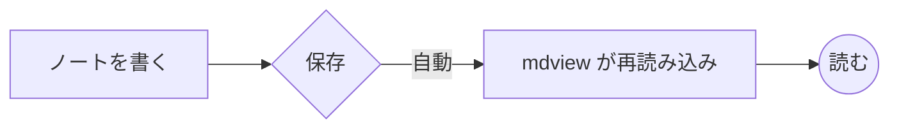
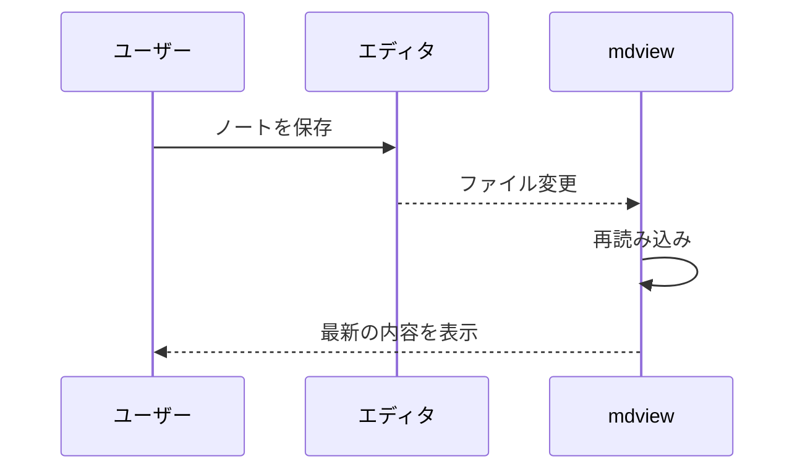

# mdview サンプル

**mdview** は、フォルダの Markdown ノートを快適に読むためのビューアです。*強調*、**太字**、~~取り消し線~~、`inline code`、<kbd>Ctrl</kbd>+<kbd>P</kbd>、<mark>マーカー</mark> などのインライン要素に対応しています。
日本語の文章は改行してもスペースが入らずに
自然につながります。


## リンク

- 外部リンク: [Rust](https://www.rust-lang.org/)
- 別のノート: [使い方ガイド](guide/getting-started.md)
- 見出しへ: [表のセクション](#表)
- ノート内の見出し: [高度な機能の脚注](guide/advanced/features.md#脚注)
- Wiki リンク: [[getting-started|使い方ガイド（Wiki リンク）]] / [[features#見出しへのリンク]]

リンクにマウスを乗せると、リンク先の内容がポップアップで表示されます。

## リスト

1. 番号付きリスト
2. ネストもできます
   - 箇条書き
     - さらに深く
       - 4 段目
3. 3 番目

- [x] タスクリスト（完了）
- [ ] タスクリスト（未完了）

## 表

| 機能 | ショートカット | 備考 |
|:-----|:------:|----:|
| ファイルを開く | `Ctrl+P` | あいまい検索 |
| ページ内検索 | `Ctrl+F` | ハイライト付き |
| 全文検索 | `Ctrl+Shift+F` | フォルダ全体 |
| 戻る / 進む | `Alt+←` / `Alt+→` | マウスのサイドボタンも可 |

## コード

```rust
use std::collections::HashMap;

/// 単語の出現回数を数える
fn count_words(text: &str) -> HashMap<&str, usize> {
    let mut map = HashMap::new();
    for w in text.split_whitespace() {
        *map.entry(w).or_insert(0) += 1;
    }
    map
}
```

```python
def fib(n: int) -> int:
    return n if n < 2 else fib(n - 1) + fib(n - 2)
```

## 引用と注記

> 引用文はこのように表示されます。
> 複数行にわたっても大丈夫です。

> [!NOTE]
> 補足情報です。

> [!TIP]
> 便利なヒント。

> [!WARNING]
> 注意が必要な内容です。

## 折りたたみ

<details>
<summary>クリックで開く</summary>

折りたたまれていた内容です。**Markdown** も使えます。

- 項目 1
- 項目 2

</details>

## 図（Mermaid）





## 数式

インライン数式 $E = mc^2$、$\alpha + \beta \leq \sqrt{x}$ と、ブロック数式:

$$
\int_0^\infty e^{-x^2} dx = \frac{\sqrt{\pi}}{2}
$$

$$
\sum_{k=1}^{n} k^2 = \frac{n(n+1)(2n+1)}{6}
$$

<p align="center">
  
  <br>HTML ブロック内の画像も表示されます
</p>

---

脚注も使えます[^1]。

[^1]: これが脚注の本文です。
